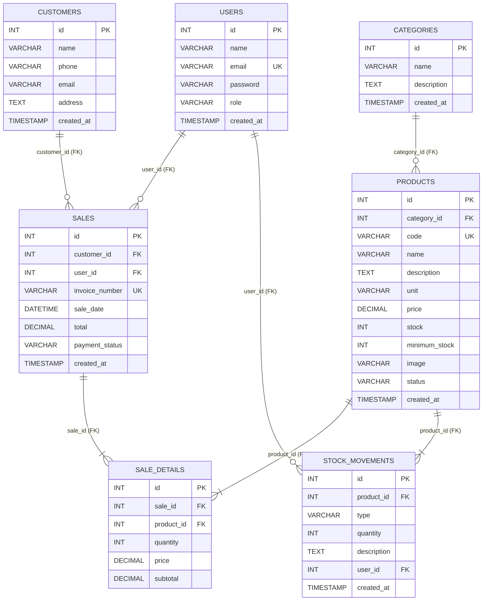

# Dokumentasi Database Schema: `toko`

> Generated from `schema.sql` — Database untuk sistem penjualan & stok material bangunan + alat berat

---

## 📋 Daftar Isi

1. [Overview](#overview)
2. [Entity Relationship Diagram](#entity-relationship-diagram)
3. [Detail Tabel](#detail-tabel)
4. [Foreign Key Relationships](#foreign-key-relationships)
5. [Indexes & Constraints](#indexes--constraints)
6. [Seed Data](#seed-data)
7. [Business Rules](#business-rules)
8. [Common Queries](#common-queries)

---

## Overview

| Property | Value |
|----------|-------|
| **Database** | `toko` |
| **Engine** | InnoDB (MySQL/MariaDB) |
| **Charset** | Default (utf8mb4 recommended) |
| **Tables** | 7 tabel utama |
| **Relationships** | 7 Foreign Keys |
| **Purpose** | POS + Inventory untuk toko material bangunan & alat berat |

---

## Entity Relationship Diagram



---

## Detail Tabel

### 1. `users` — Pengguna Sistem (Admin & Kasir)

| Kolom | Tipe | Nullable | Default | Keterangan |
|-------|------|----------|---------|------------|
| `id` | `INT` | NO | `AUTO_INCREMENT` | Primary Key |
| `name` | `VARCHAR(100)` | NO | — | Nama lengkap |
| `email` | `VARCHAR(100)` | NO | — | **UNIQUE**, login credential |
| `password` | `VARCHAR(255)` | NO | — | Hashed (bcrypt) |
| `role` | `VARCHAR(50)` | NO | `'cashier'` | `'admin'` \| `'cashier'` |
| `created_at` | `TIMESTAMP` | NO | `CURRENT_TIMESTAMP` | Waktu registrasi |

**Indexes:** `PRIMARY KEY (id)`, `UNIQUE KEY (email)`

**Seed Data:**
```sql
INSERT INTO users (name, email, password, role) VALUES
('Administrator', 'admin@example.com', '$2y$12$rvxiPNaTRPv4YEz.6YgbVu7zVdDL90zP1pzm35iFG79lzDRtC.p1u', 'admin'),
('Kasir Satu', 'kasir1@example.com', '$2y$12$aMCPEfOnFaub6wgdVCmuNOSEuCtJZgy44HPFaZo2VyH3pA8LXWVeW', 'cashier');
```

---

### 2. `categories` — Kategori Produk

| Kolom | Tipe | Nullable | Default | Keterangan |
|-------|------|----------|---------|------------|
| `id` | `INT` | NO | `AUTO_INCREMENT` | Primary Key |
| `name` | `VARCHAR(100)` | NO | — | Nama kategori |
| `description` | `TEXT` | YES | `NULL` | Deskripsi opsional |
| `created_at` | `TIMESTAMP` | NO | `CURRENT_TIMESTAMP` | — |

**Indexes:** `PRIMARY KEY (id)`

**Seed Data:** 23 kategori (ID 1–23)
- **Material Bangunan (1–11):** Semen, Pasir, Bata, Batako, Beton, Besi & Baja, Kayu, Pipa, Atap, Cat, Keramik
- **Alat Berat (12–23):** Excavator, Crane, Bulldozer, Wheel Loader, Forklift, Dump Truck, Concrete Mixer, Compactor, Motor Grader, Asphalt Paver, Concrete Pump, Genset

---

### 3. `products` — Master Produk / Barang

| Kolom | Tipe | Nullable | Default | Keterangan |
|-------|------|----------|---------|------------|
| `id` | `INT` | NO | `AUTO_INCREMENT` | Primary Key |
| `category_id` | `INT` | YES | `NULL` | FK → `categories.id` |
| `code` | `VARCHAR(50)` | NO | — | **UNIQUE**, kode barang (ex: `SEM-001`) |
| `name` | `VARCHAR(150)` | NO | — | Nama produk |
| `description` | `TEXT` | YES | `NULL` | Deskripsi |
| `unit` | `VARCHAR(50)` | NO | — | Satuan: `Sak`, `m³`, `Buah`, `Batang`, `Lembar`, `Kaleng`, `Dus`, `Unit` |
| `price` | `DECIMAL(10,2)` | NO | `0.00` | Harga jual |
| `stock` | `INT` | NO | `0` | Stok tersedia |
| `minimum_stock` | `INT` | NO | `0` | Batas minimum (untuk alert) |
| `image` | `VARCHAR(255)` | YES | `NULL` | Path gambar |
| `status` | `VARCHAR(50)` | NO | `'active'` | `'active'` \| `'inactive'` \| `'discontinued'` |
| `created_at` | `TIMESTAMP` | NO | `CURRENT_TIMESTAMP` | — |

**Indexes:** `PRIMARY KEY (id)`, `UNIQUE KEY (code)`, `KEY (category_id)`

**Foreign Key:**
```sql
FOREIGN KEY (category_id) REFERENCES categories(id) ON DELETE SET NULL
```

**Seed Data:** 40 produk (ID 1–40)
- Contoh: `SEM-001` Semen Portland 50kg @ Rp65.000, `EXC-001` Excavator 20 Ton @ Rp1.5M

---

### 4. `customers` — Pelanggan

| Kolom | Tipe | Nullable | Default | Keterangan |
|-------|------|----------|---------|------------|
| `id` | `INT` | NO | `AUTO_INCREMENT` | Primary Key |
| `name` | `VARCHAR(100)` | NO | — | Nama pelanggan |
| `phone` | `VARCHAR(20)` | YES | `NULL` | No. telepon |
| `email` | `VARCHAR(100)` | YES | `NULL` | Email |
| `address` | `TEXT` | YES | `NULL` | Alamat lengkap |
| `created_at` | `TIMESTAMP` | NO | `CURRENT_TIMESTAMP` | — |

**Indexes:** `PRIMARY KEY (id)`

**Seed Data:**
```sql
('Pelanggan Umum', '081234567890', 'pelanggan@example.com', 'Jl. Merdeka No. 1'),
('Budi Santoso', '081298765432', 'budi@example.com', 'Jl. Sudirman No. 45');
```

---

### 5. `sales` — Transaksi Penjualan (Header)

| Kolom | Tipe | Nullable | Default | Keterangan |
|-------|------|----------|---------|------------|
| `id` | `INT` | NO | `AUTO_INCREMENT` | Primary Key |
| `customer_id` | `INT` | YES | `NULL` | FK → `customers.id` (walk-in = NULL) |
| `user_id` | `INT` | YES | `NULL` | FK → `users.id` (kasir yg proses) |
| `invoice_number` | `VARCHAR(50)` | NO | — | **UNIQUE**, nomor nota (ex: `INV-20260115-001`) |
| `sale_date` | `DATETIME` | NO | `CURRENT_TIMESTAMP` | Tanggal transaksi |
| `total` | `DECIMAL(10,2)` | NO | `0.00` | Grand total |
| `payment_status` | `VARCHAR(50)` | NO | `'pending'` | `'pending'` \| `'paid'` \| `'partial'` \| `'cancelled'` |
| `created_at` | `TIMESTAMP` | NO | `CURRENT_TIMESTAMP` | Waktu input sistem |

**Indexes:** `PRIMARY KEY (id)`, `UNIQUE KEY (invoice_number)`, `KEY (customer_id)`, `KEY (user_id)`

**Foreign Keys:**
```sql
FOREIGN KEY (customer_id) REFERENCES customers(id) ON DELETE SET NULL,
FOREIGN KEY (user_id) REFERENCES users(id) ON DELETE SET NULL
```

---

### 6. `sale_details` — Detail Barang per Transaksi

| Kolom | Tipe | Nullable | Default | Keterangan |
|-------|------|----------|---------|------------|
| `id` | `INT` | NO | `AUTO_INCREMENT` | Primary Key |
| `sale_id` | `INT` | NO | — | FK → `sales.id` |
| `product_id` | `INT` | NO | — | FK → `products.id` |
| `quantity` | `INT` | NO | — | Jumlah beli |
| `price` | `DECIMAL(10,2)` | NO | `0.00` | Harga saat transaksi (snapshot) |
| `subtotal` | `DECIMAL(10,2)` | NO | `0.00` | `quantity * price` |

**Indexes:** `PRIMARY KEY (id)`, `KEY (sale_id)`, `KEY (product_id)`

**Foreign Keys:**
```sql
FOREIGN KEY (sale_id) REFERENCES sales(id) ON DELETE CASCADE,
FOREIGN KEY (product_id) REFERENCES products(id) ON DELETE CASCADE
```

> **Catatan:** `price` disimpan sebagai *snapshot* agar histori harga tidak berubah jika master produk di-update.

---

### 7. `stock_movements` — Riwayat Gerakan Stok (Mutasi)

| Kolom | Tipe | Nullable | Default | Keterangan |
|-------|------|----------|---------|------------|
| `id` | `INT` | NO | `AUTO_INCREMENT` | Primary Key |
| `product_id` | `INT` | NO | — | FK → `products.id` |
| `type` | `VARCHAR(50)` | NO | — | `'in'` \| `'out'` \| `'adjustment'` \| `'return'` \| `'transfer'` |
| `quantity` | `INT` | NO | — | Jumlah (positif untuk in, negatif untuk out) |
| `description` | `TEXT` | YES | `NULL` | Keterangan (ex: "Pembelian PO#123", "Retur nota #5") |
| `user_id` | `INT` | YES | `NULL` | FK → `users.id` (petugas) |
| `created_at` | `TIMESTAMP` | NO | `CURRENT_TIMESTAMP` | Waktu gerakan |

**Indexes:** `PRIMARY KEY (id)`, `KEY (product_id)`, `KEY (user_id)`

**Foreign Keys:**
```sql
FOREIGN KEY (product_id) REFERENCES products(id) ON DELETE CASCADE,
FOREIGN KEY (user_id) REFERENCES users(id) ON DELETE SET NULL
```

---

## Foreign Key Relationships

### Summary Table

| # | Child Table | FK Column | Parent Table | Parent Column | ON DELETE | Rule |
|---|-------------|-----------|--------------|---------------|-----------|------|
| 1 | `products` | `category_id` | `categories` | `id` | `SET NULL` | Kategori dihapus → produk tetap ada, kategori jadi NULL |
| 2 | `sales` | `customer_id` | `customers` | `id` | `SET NULL` | Customer dihapus → nota tetap ada |
| 3 | `sales` | `user_id` | `users` | `id` | `SET NULL` | Kasir dihapus → nota tetap ada |
| 4 | `sale_details` | `sale_id` | `sales` | `id` | `CASCADE` | Nota dihapus → detail **ikut terhapus** |
| 5 | `sale_details` | `product_id` | `products` | `id` | `CASCADE` | Produk dihapus → detail nota **ikut terhapus** |
| 6 | `stock_movements` | `product_id` | `products` | `id` | `CASCADE` | Produk dihapus → riwayat stok **ikut terhapus** |
| 7 | `stock_movements` | `user_id` | `users` | `id` | `SET NULL` | Kasir dihapus → riwayat stok tetap ada |

### Visual Flow

```
CATEGORIES (1) ◄──── SET NULL ────► (N) PRODUCTS
CUSTOMERS  (1) ◄──── SET NULL ────► (N) SALES
USERS      (1) ◄──── SET NULL ────► (N) SALES
USERS      (1) ◄──── SET NULL ────► (N) STOCK_MOVEMENTS
SALES      (1) ◄──── CASCADE ──────► (N) SALE_DETAILS
PRODUCTS   (1) ◄──── CASCADE ──────► (N) SALE_DETAILS
PRODUCTS   (1) ◄──── CASCADE ──────► (N) STOCK_MOVEMENTS
```

### Why These Rules?

| Rule | Tables | Reason |
|------|--------|--------|
| **CASCADE** | `sale_details`, `stock_movements` | Data detail **tidak boleh orphan** — tanpa parent (nota/produk) tidak bermakna |
| **SET NULL** | `products.category_id`, `sales.customer_id`, `sales.user_id`, `stock_movements.user_id` | Data master (kategori, customer, kasir) **bisa dihapus** tanpa merusak transaksi historis (audit trail) |

---

## Indexes & Constraints

### Primary Keys
- All tables: `id` (AUTO_INCREMENT)

### Unique Keys
| Table | Column | Purpose |
|-------|--------|---------|
| `users` | `email` | Login unik |
| `products` | `code` | Kode barang unik (SKU) |
| `sales` | `invoice_number` | Nomor nota unik |

### Foreign Key Indexes (Auto-created by InnoDB)
| Table | Column |
|-------|--------|
| `products` | `category_id` |
| `sales` | `customer_id`, `user_id` |
| `sale_details` | `sale_id`, `product_id` |
| `stock_movements` | `product_id`, `user_id` |

### Suggested Additional Indexes (for performance)
```sql
-- Untuk query laporan penjualan per tanggal
CREATE INDEX idx_sales_sale_date ON sales(sale_date);

-- Untuk query stok rendah
CREATE INDEX idx_products_stock ON products(stock, minimum_stock);

-- Untuk query mutasi stok per produk per periode
CREATE INDEX idx_stock_movements_product_date ON stock_movements(product_id, created_at);

-- Untuk query nota by kasir
CREATE INDEX idx_sales_user_date ON sales(user_id, sale_date);
```

---

## Seed Data

### Users (2)
| id | name | email | role |
|----|------|-------|------|
| 1 | Administrator | admin@example.com | admin |
| 2 | Kasir Satu | kasir1@example.com | cashier |

### Categories (23)
| Range | Group | Count |
|-------|-------|-------|
| 1–11 | Material Bangunan | 11 |
| 12–23 | Alat Berat | 12 |

### Products (40)
| Category | Kode | Nama | Harga | Stok | Min |
|----------|------|------|-------|------|-----|
| Semen (1) | SEM-001 | Semen Portland 50kg | 65.000 | 100 | 10 |
| Semen (1) | SEM-002 | Semen Mortar 40kg | 85.000 | 80 | 10 |
| Pasir (2) | PAS-001 | Pasir Bangunan | 250.000 | 20 | 5 |
| ... | ... | ... | ... | ... | ... |
| Excavator (12) | EXC-001 | Excavator 20 Ton | 1.500.000.000 | 2 | 1 |
| Genset (23) | GEN-002 | Genset 100 KVA | 1.950.000.000 | 2 | 1 |

### Customers (2)
| id | name | phone | email |
|----|------|-------|-------|
| 1 | Pelanggan Umum | 081234567890 | pelanggan@example.com |
| 2 | Budi Santoso | 081298765432 | budi@example.com |

---

## Business Rules

### 1. Produk
- `code` harus unik (SKU)
- `stock` tidak boleh negatif (enforce di application layer / trigger)
- `minimum_stock` untuk alert restock
- `status = 'inactive'` → tidak dijual tapi data tetap ada

### 2. Penjualan (Sales)
- `invoice_number` format bebas tapi unik (rekomendasi: `INV-YYYYMMDD-XXX`)
- `total` = Σ `sale_details.subtotal` (hitung di app, simpan di header untuk query cepat)
- `payment_status`:
  - `pending` → baru dibuat
  - `paid` → lunas
  - `partial` → DP / cicilan
  - `cancelled` → batal (stok harus di-rollback via `stock_movements type='return'`)

### 3. Sale Details
- `price` = snapshot harga produk **saat transaksi** (bukan ambil dari master real-time)
- `subtotal` = `quantity * price`
- 1 produk bisa muncul berkali-kali di 1 nota (baris terpisah) — *allowed*

### 4. Stock Movements
| Type | Keterangan | Quantity |
|------|------------|----------|
| `in` | Pembelian / restock | Positif |
| `out` | Penjualan / pakai internal | Negatif |
| `adjustment` | Koreksi stok (opname) | +/- |
| `return` | Retur pembeli / supplier | +/- |
| `transfer` | Pindah gudang | +/- |

- Setiap `sale_details` insert → **harus** buat `stock_movements` type `out`
- Setiap pembelian (belum ada tabel `purchases`) → buat `stock_movements` type `in`

### 5. Soft Delete Pattern
- `products.status = 'inactive'` atau `categories` dihapus (SET NULL) → data historis terjaga
- `sales` tidak dihapus (CASCADE ke detail), gunakan `payment_status = 'cancelled'`

---

## Common Queries

### 1. Nota Lengkap (Header + Detail + Produk + Customer + Kasir)
```sql
SELECT
    s.invoice_number,
    s.sale_date,
    c.name AS customer_name,
    u.name AS cashier_name,
    p.code,
    p.name AS product_name,
    sd.quantity,
    sd.price,
    sd.subtotal,
    s.total,
    s.payment_status
FROM sales s
LEFT JOIN customers c ON s.customer_id = c.id
LEFT JOIN users u ON s.user_id = u.id
JOIN sale_details sd ON s.id = sd.sale_id
JOIN products p ON sd.product_id = p.id
WHERE s.id = 1
ORDER BY sd.id;
```

### 2. Stok Saat Ini + Status Minimum
```sql
SELECT
    p.code,
    p.name,
    cat.name AS category,
    p.stock,
    p.minimum_stock,
    CASE
        WHEN p.stock <= p.minimum_stock THEN 'REORDER'
        WHEN p.stock <= p.minimum_stock * 2 THEN 'LOW'
        ELSE 'OK'
    END AS stock_status
FROM products p
LEFT JOIN categories cat ON p.category_id = cat.id
WHERE p.status = 'active'
ORDER BY p.stock ASC;
```

### 3. Mutasi Stok Per Produk (30 hari terakhir)
```sql
SELECT
    p.code,
    p.name,
    sm.type,
    sm.quantity,
    sm.description,
    sm.created_at,
    u.name AS petugas
FROM stock_movements sm
JOIN products p ON sm.product_id = p.id
LEFT JOIN users u ON sm.user_id = u.id
WHERE sm.created_at >= DATE_SUB(NOW(), INTERVAL 30 DAY)
  AND p.id = 1
ORDER BY sm.created_at DESC;
```

### 4. Laporan Penjualan Per Periode
```sql
SELECT
    DATE(s.sale_date) AS tanggal,
    COUNT(s.id) AS total_transaksi,
    SUM(s.total) AS total_omzet,
    SUM(CASE WHEN s.payment_status = 'paid' THEN s.total ELSE 0 END) AS omzet_lunas,
    SUM(CASE WHEN s.payment_status = 'pending' THEN s.total ELSE 0 END) AS piutang
FROM sales s
WHERE s.sale_date BETWEEN '2026-01-01' AND '2026-01-31'
  AND s.payment_status != 'cancelled'
GROUP BY DATE(s.sale_date)
ORDER BY tanggal;
```

### 5. Top 10 Produk Terlaris
```sql
SELECT
    p.code,
    p.name,
    SUM(sd.quantity) AS total_terjual,
    SUM(sd.subtotal) AS total_pendapatan
FROM sale_details sd
JOIN products p ON sd.product_id = p.id
JOIN sales s ON sd.sale_id = s.id
WHERE s.payment_status != 'cancelled'
  AND s.sale_date >= DATE_SUB(NOW(), INTERVAL 90 DAY)
GROUP BY p.id, p.code, p.name
ORDER BY total_terjual DESC
LIMIT 10;
```

---

## Migration / Deployment Notes

### Create Database
```bash
mysql -u root -p < schema.sql
```

### Reset & Re-seed (Development)
```bash
mysql -u root -p -e "DROP DATABASE IF EXISTS toko; CREATE DATABASE toko;"
mysql -u root -p toko < schema.sql
```

### Backup
```bash
mysqldump -u root -p toko > backup_toko_$(date +%F).sql
```

### Restore
```bash
mysql -u root -p toko < backup_toko_2026-01-15.sql
```

---

## Version History

| Version | Date | Changes |
|---------|------|---------|
| 1.0 | 2026-01-15 | Initial schema: users, categories, products, customers, sales, sale_details, stock_movements |

---

## License & Ownership

Internal use only — PT. Toko Material Jaya (fictional)

---

*Generated automatically from `schema.sql` — Do not edit this file directly; update `schema.sql` instead.*