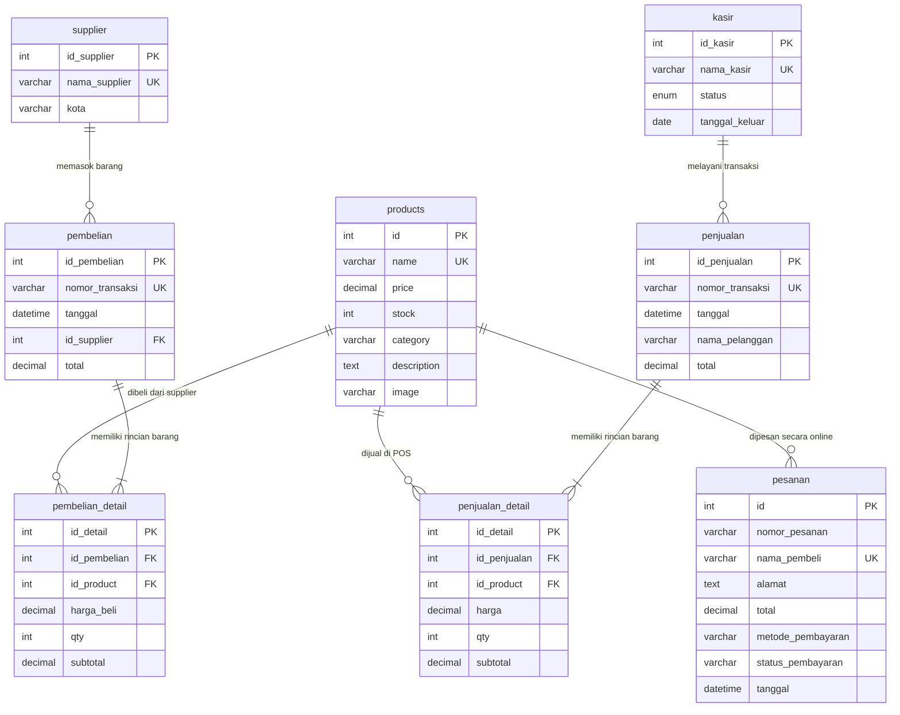
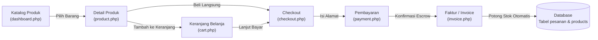

# DOKUMENTASI LENGKAP PROYEK WEEKLYWORK (darkfonder.net)

Dokumen ini berisi panduan dan penjelasan teknis menyeluruh mengenai arsitektur, basis data, alur bisnis, modul aplikasi, keamanan, panduan setup, serta tata kelola kode pada repositori **WeeklyWork** (`darkfonder.net`).

---

## DAFTAR ISI
1. [Ringkasan & Gambaran Umum Proyek](#1-ringkasan--gambaran-umum-proyek)
2. [Teknologi yang Digunakan (Tech Stack)](#2-teknologi-yang-digunakan-tech-stack)
3. [Arsitektur & Struktur Direktori](#3-arsitektur--struktur-direktori)
4. [Sistem Autentikasi & Hak Akses (Multi-Role)](#4-sistem-autentikasi--hak-akses-multi-role)
5. [Skema & Desain Basis Data (Database Schema)](#5-skema--desain-basis-data-database-schema)
6. [Penjelasan Alur Kerja & Modul Aplikasi](#6-penjelasan-alur-kerja--modul-aplikasi)
   - 6.1 [Storefront / Modul E-Commerce Pelanggan (`home/`)](#61-storefront--modul-e-commerce-pelanggan-home)
   - 6.2 [Modul Backoffice & Administrasi (`admin/`)](#62-modul-backoffice--administrasi-admin)
   - 6.3 [Modul Point of Sales / Penjualan Kasir (`admin/penjualan/`)](#63-modul-point-of-sales--penjualan-kasir-adminpenjualan)
   - 6.4 [Modul Pengadaan Stok / Pembelian Supplier (`admin/pembelian/`)](#64-modul-pengadaan-stok--pembelian-supplier-adminpembelian)
   - 6.5 [Modul System Checklist (`admin/checklist.php`)](#65-modul-system-checklist-adminchecklistphp)
   - 6.6 [Mock Payment Gateway API (`api/payment.php`)](#66-mock-payment-gateway-api-apipaymentphp)
7. [Mekanisme Keamanan (Security Features)](#7-mekanisme-keamanan-security-features)
8. [Frontend & Desain Antarmuka (UI/UX)](#8-frontend--desain-antarmuka-uiux)
9. [Panduan Instalasi & Menjalankan Sistem (Setup Guide)](#9-panduan-instalasi--menjalankan-sistem-setup-guide)
10. [Aturan Kontribusi Tim, Git Flow & Issue Tracking](#10-aturan-kontribusi-tim-git-flow--issue-tracking)

---

## 1. Ringkasan & Gambaran Umum Proyek

**WeeklyWork (`darkfonder.net`)** adalah aplikasi web berbasis PHP Native yang menggabungkan dua ekosistem utama:
1. **E-Commerce Storefront**: Katalog penjualan produk online yang dilengkapi keranjang belanja (*cart*), proses pembayaran (*checkout* & *payment gateway simulation*), serta penerbitan faktur pembelian (*invoice*).
2. **Point of Sale (POS) & Backoffice ERP Mini**: Panel administrasi untuk mengelola data master (produk, kasir, supplier), transaksi penjualan kasir (POS), pengadaan stok dari supplier (pembelian), dan pemantauan integritas data sistem (*system checklist*).

Proyek ini dirancang dengan gaya penulisan kode **prosedural yang terstruktur dan mudah dipahami oleh junior developer** (tanpa dependensi framework besar yang rumit), memprioritaskan performa langsung menggunakan ekstensi PHP `mysqli`, validasi sisi server yang ketat, serta pengamanan sesi dan token.

---

## 2. Teknologi yang Digunakan (Tech Stack)

| Komponen | Teknologi | Penjelasan |
| :--- | :--- | :--- |
| **Backend Runtime** | PHP 7.4 / PHP 8.x | Berjalan dengan mode procedural murni, mudah didebug dan dipelajari. |
| **Basis Data** | MySQL / MariaDB | Menggunakan driver `mysqli` dengan *prepared statements* untuk seluruh operasi DML. |
| **Web Server** | Apache (XAMPP / LAMPP) | Menggunakan `.htaccess` untuk rewrite dan konfigurasi lingkungan lokal. |
| **Frontend UI** | HTML5, CSS3, Vanilla JS | Desain minimalis responsif dengan fitur tema ganda (*light/dark* mode) tanpa framework CSS luar. |
| **Keamanan** | Native PHP Sessions & CSRF Token | Dilengkapi mekanisme auto session timeout (30 menit) dan perlindungan CSRF berbasis `random_bytes`. |

---

## 3. Arsitektur & Struktur Direktori

Berikut adalah pohon direktori proyek dan fungsi masing-masing berkas:

```text
weeklywork/
│
├── .htaccess                 # Konfigurasi Apache rewrite dan opsi direktori
├── .php-cs-fixer.dist.php    # Standarisasi gaya penulisan kode PHP
├── ai-instruction.md         # Petunjuk khusus bagi kontributor / AI agar menjaga kode tetap ramah pemula
├── index.php                 # Gerbang masuk utama (Login autentikasi berbasis Token)
├── logout.php                # Pemusnahan sesi aman & pengalihan ke halaman awal
├── readme.md                 # Catatan awal tim, aturan commit, dan setup kilat
├── todo.md                   # Pelacakan issue/bug yang telah diselesaikan dan daftar tugas anggota tim
├── token.example.php         # Berkas contoh konfigurasi token statis
├── token.php                 # Konfigurasi token rahasia login (diabaikan oleh git)
├── schema.sql                # Definisi DDL tabel lengkap dan data awal (seed)
│
├── admin/                    # MODUL PANEL KONTROL ADMINISTRATOR & KASIR
│   ├── admin.php             # Dashboard admin (ringkasan sistem & 10 pesanan online terakhir)
│   ├── checklist.php         # Audit kesehatan sistem & keberadaan tabel basis data
│   ├── guard.php             # Middleware pengaman halaman admin (memeriksa sesi dan role)
│   │
│   ├── cashier/              # Manajemen Kasir (CRUD Kasir)
│   │   ├── cashier.php       # Tampilan tabel daftar kasir
│   │   ├── newcashier.php    # Form penambahan kasir baru
│   │   ├── editcashier.php   # Form edit nama kasir
│   │   └── offcashier.php    # Aksi nonaktifkan kasir & catat tanggal keluar
│   │
│   ├── product/              # Manajemen Produk (CRUD Produk)
│   │   ├── product.php       # Tampilan tabel inventaris produk barang
│   │   ├── addproduct.php    # Form penambahan produk baru
│   │   ├── editproduct.php   # Form ubah data produk & stok
│   │   └── delproduct.php    # Aksi hapus produk dari database
│   │
│   ├── supplier/             # Manajemen Supplier (CRUD Supplier)
│   │   ├── supplier.php      # Daftar vendor/supplier rekanan
│   │   ├── addsupplier.php   # Form tambah supplier baru
│   │   ├── editsupplier.php  # Form ubah informasi supplier
│   │   └── delsupplier.php   # Aksi hapus data supplier
│   │
│   ├── penjualan/            # Modul Transaksi Penjualan Kasir (POS)
│   │   ├── penjualan.php     # Riwayat seluruh transaksi penjualan offline
│   │   ├── penjualan_tambah.php # Form transaksi kasir (memotong stok otomatis)
│   │   └── penjualan_detail.php # Rincian item yang dibeli per nota transaksi
│   │
│   └── pembelian/            # Modul Pengadaan Stok dari Supplier
│       ├── pembelian.php     # Riwayat pengadaan / pembelian barang masuk
│       ├── pembelian_tambah.php # Form penerimaan barang (menambah stok otomatis)
│       └── pembelian_detail.php # Rincian item pembelian per nomor transaksi
│
├── api/                      # ENDPOINT LAYANAN REST / JSON
│   └── payment.php           # Mock endpoint untuk pemrosesan pembayaran gateway
│
├── assets/                   # ASSET STATIS
│   ├── style.css             # Desain tata letak, typography, dan skema warna dark/light mode
│   ├── main.js               # Pengalih tema, fungsi dialog konfirmasi, & reveal token
│   └── transaksi.js          # Kalkulasi otomatis subtotal dan pengisian harga barang dinamis
│
├── config/                   # KONFIGURASI APLIKASI
│   ├── database.example.php  # Template berkas koneksi basis data
│   └── database.php          # Konfigurasi aktif koneksi database MySQL lokal
│
├── home/                     # STOREFRONT / MODUL TOKO ONLINE
│   ├── dashboard.php         # Halaman katalog produk utama (search, filter, sort, pagination)
│   ├── product.php           # Halaman detail produk tunggal
│   ├── cart.php              # Keranjang belanja berbasis sesi
│   ├── checkout.php          # Formulir data alamat dan peninjauan pesanan
│   ├── payment.php           # Simulasi konfirmasi gateway pembayaran escrow
│   └── invoice.php           # Faktur pembelian resmi, pemotongan stok, simpan order, & cetak
│
├── images/                   # Asset gambar produk lokal
│
├── includes/                 # FUNGSI & PUSTAKA PEMBANTU (HELPERS)
│   ├── csrf.php              # Pembangkit dan pemverifikasi token CSRF
│   ├── gateway.php           # Simulator gateway pembayaran escrow
│   ├── items.php             # Pemuat data produk terpadu dari database ke memori
│   ├── session.php           # Konfigurasi cookie aman dan batas waktu sesi aktif (30 menit)
│   └── transaksi_helper.php  # Pembangkit nomor transaksi, inisialisasi tabel, format mata uang
│
└── partials/                 # FRAGMEN TEMPLATE MODULAR
    ├── header.php            # Kerangka pembuka HTML (dalam standarisasi tim)
    ├── footer.php            # Kerangka penutup HTML (dalam standarisasi tim)
    ├── topbar.php            # Bar navigasi atas (brand, switcher tema, link navigasi)
    └── sidebar.php           # Menu navigasi sidebar panel admin
```

---

## 4. Sistem Autentikasi & Hak Akses (Multi-Role)

Aplikasi tidak menggunakan sistem login konvensional berupa pasangan `username` + `password`, melainkan **Sistem Autentikasi Berbasis Token Tunggal** melalui halaman [index.php](file:///opt/lampp/htdocs/git/weeklywork/index.php).

### Alur Kerja Login:
1. Pengguna memasukkan token rahasia pada formulir login.
2. Skrip memvalidasi kecocokan token:
   - **Role `admin`**: Jika token cocok dengan konstanta `ADMIN_TOKEN` (didefinisikan di `token.php`), sistem menetapkan `$_SESSION['role'] = 'admin'` dan mengarahkan pengguna ke `admin/admin.php`.
   - **Role `user`**: Jika token cocok dengan konstanta `USER_TOKEN`, sistem menetapkan `$_SESSION['role'] = 'user'` dan mengarahkan pengguna ke katalog toko `home/dashboard.php`.
   - **Role `cashier`**: Jika token tidak cocok dengan konstanta statis di atas, sistem menjalankan kueri ke tabel database `kasir`:
     ```sql
     SELECT id_kasir, nama_kasir FROM kasir WHERE nama_kasir = ? AND status = 'aktif' LIMIT 1
     ```
     Jika nama kasir ditemukan dan berstatus `aktif`, sesi kasir diaktifkan (`$_SESSION['role'] = 'cashier'`) dan diarahkan ke `home/dashboard.php` atau modul admin yang diizinkan.
   - **Gagal**: Jika tidak ada token yang valid, pesan error `"invalid token"` ditampilkan.

### Hak Akses per Peran:
| Halaman / Fitur | Pengunjung Publik | Role: `user` | Role: `cashier` | Role: `admin` |
| :--- | :---: | :---: | :---: | :---: |
| Halaman Login (`index.php`) | Akses | Redirect | Redirect | Redirect |
| Katalog Toko (`home/dashboard.php`) | Blokir | Diizinkan | Diizinkan | Diizinkan |
| Keranjang & Checkout Online (`home/`) | Blokir | Diizinkan | Diizinkan | Diizinkan |
| Dashboard Admin (`admin/admin.php`) | Blokir | Blokir | Blokir | Diizinkan |
| Kelola Produk, Kasir, Supplier | Blokir | Blokir | Blokir | Diizinkan |
| Transaksi POS Penjualan (`admin/penjualan/`) | Blokir | Blokir | Diizinkan | Diizinkan |
| Transaksi Pembelian Stok (`admin/pembelian/`) | Blokir | Blokir | Diizinkan | Diizinkan |
| Audit Checklist Database (`admin/checklist.php`) | Blokir | Blokir | Diizinkan | Diizinkan |

Semua berkas di folder `admin/` dilindungi oleh `admin/guard.php` yang secara otomatis memutus akses pengguna yang tidak memiliki hak otorisasi yang sah.

---

## 5. Skema & Desain Basis Data (Database Schema)

Basis data diberi nama standar **`toko`**. Terdapat 8 tabel yang saling mendukung alur e-commerce dan pencatatan transaksi kasir:



### Kamus Data (Data Dictionary)

#### 1. Tabel `products`
Menyimpan katalog inventaris barang dagangan:
- `id` (INT, Primary Key, Auto Increment)
- `name` (VARCHAR(100), UNIQUE, NOT NULL): Nama produk
- `price` (DECIMAL(10,2), NOT NULL): Harga jual barang
- `stock` (INT, NOT NULL): Sisa kuantitas stok di gudang
- `category` (VARCHAR(50), NOT NULL): Kategori (misal: *pistol, rifle, shotgun, submachine, melee*)
- `description` (TEXT, NOT NULL): Deskripsi spesifikasi barang
- `image` (VARCHAR(255), DEFAULT 'images/glock17.png'): Path direktori lokal gambar barang

#### 2. Tabel `kasir`
Menyimpan data staf kasir dan status penugasannya:
- `id_kasir` (INT, Primary Key, Auto Increment)
- `nama_kasir` (VARCHAR(50), UNIQUE, NOT NULL): Nama kasir (berfungsi juga sebagai token login)
- `status` (ENUM('aktif','nonaktif'), DEFAULT 'aktif')
- `tanggal_keluar` (DATE, DEFAULT NULL): Tanggal pencatatan saat kasir dinonaktifkan

#### 3. Tabel `supplier`
Menyimpan data vendor pemasok barang:
- `id_supplier` (INT, Primary Key, Auto Increment)
- `nama_supplier` (VARCHAR(50), UNIQUE, NOT NULL): Nama perusahaan / penyedia
- `kota` (VARCHAR(30), DEFAULT NULL): Domisili kota supplier

#### 4. Tabel `pesanan`
Menyimpan transaksi pesanan online yang dilakukan pelanggan melalui storefront:
- `id` (INT, Primary Key, Auto Increment)
- `nomor_pesanan` (VARCHAR(50), NOT NULL): Nomor referensi pesanan (misal: `ORD-XXXXX`)
- `nama_pembeli` (VARCHAR(100), NOT NULL, UNIQUE): Nama penerima pesanan
- `alamat` (TEXT, NOT NULL): Alamat lengkap pengiriman barang
- `total` (DECIMAL(10,2), NOT NULL): Total tagihan (termasuk biaya pengiriman)
- `metode_pembayaran` (VARCHAR(50), NOT NULL): Metode bayar yang dipilih (cth: `crypto escrow`)
- `status_pembayaran` (VARCHAR(50), NOT NULL): Status proses (cth: `escrow pending`, `paid`)
- `tanggal` (DATETIME, DEFAULT CURRENT_TIMESTAMP)

#### 5. Tabel `penjualan` & `penjualan_detail`
Mencatat transaksi penjualan langsung di toko fisik oleh kasir (POS):
- `penjualan`: Header nota transaksi (`id_penjualan`, `nomor_transaksi` [format: `PJL-YYYYMMDDHHMMSS-XXX`], `tanggal`, `nama_pelanggan`, `total`).
- `penjualan_detail`: Rincian per item (`id_detail`, `id_penjualan`, `id_product`, `harga`, `qty`, `subtotal`).

#### 6. Tabel `pembelian` & `pembelian_detail`
Mencatat pengadaan barang masuk dari supplier:
- `pembelian`: Header nota pembelian stok (`id_pembelian`, `nomor_transaksi` [format: `PBL-YYYYMMDDHHMMSS-XXX`], `tanggal`, `id_supplier`, `total`).
- `pembelian_detail`: Rincian barang masuk (`id_detail`, `id_pembelian`, `id_product`, `harga_beli`, `qty`, `subtotal`).

---

## 6. Penjelasan Alur Kerja & Modul Aplikasi

### 6.1 Storefront / Modul E-Commerce Pelanggan (`home/`)

Alur transaksi pelanggan online dirancang dengan langkah-langkah terstruktur berikut:



1. **`home/dashboard.php`**:
   - Menampilkan daftar produk aktif dengan pembagian halaman (*pagination*) sebesar 6 produk per halaman.
   - Dilengkapi fitur pencarian kata kunci (`name` & `description`) dan filter kategori dropdown.
   - Pilihan penyortiran dinamis: harga terendah (*low*), harga tertinggi (*high*), atau abjad nama produk (*name*).
2. **`home/product.php`**:
   - Menampilkan foto besar, spesifikasi lengkap, ketersediaan stok aktual, dan opsi beli langsung atau simpan ke keranjang.
3. **`home/cart.php`**:
   - Mengelola array `$_SESSION['cart']` yang menyimpan pasangan `id_produk => kuantitas`.
   - Melakukan validasi ketat batas stok sebelum menambah item.
   - Menyediakan fitur update jumlah, hapus satuan barang, dan pengosongan seluruh isi keranjang belanja.
4. **`home/checkout.php`**:
   - Menghitung ulang nilai subtotal secara server-side ditambah ongkos kirim standar ($5.00).
   - Menyediakan form input nama pembeli, alamat, dan kota pengiriman.
5. **`home/payment.php`**:
   - Simulasi pemilihan gateway pembayaran (*crypto escrow*, *direct transfer*, dll).
   - Memanggil fungsi backend `processgatewaypayment()` dari `includes/gateway.php`.
6. **`home/invoice.php`**:
   - Halaman final transaksi:
     - Menyimpan data transaksi ke tabel `pesanan`.
     - **Memotong stok produk** secara real-time di tabel `products` (`stock = stock - qty`).
     - Mengosongkan keranjang belanja `$_SESSION['cart']`.
     - Menyediakan tombol *Print Invoice* (`window.print()`) untuk mencetak bukti faktur pembayaran.

---

### 6.2 Modul Backoffice & Administrasi (`admin/`)

Diperuntukkan khusus bagi staf atau manajer sistem:
- **`admin/admin.php`**:
  - Halaman ikhtisar ringkas yang menampilkan 10 data pesanan online terbaru dari tabel `pesanan`.
- **`admin/product/` (CRUD Produk)**:
  - Melihat daftar inventaris barang beserta sisa stok dan thumbnail gambar.
  - Form penambahan produk (`addproduct.php`) dan perbaikan produk (`editproduct.php`) dengan validasi nama unik dan input gambar.
  - Penghapusan produk (`delproduct.php`) dengan proteksi prepared statement.
- **`admin/cashier/` (Manajemen Kasir)**:
  - Pendaftaran akun kasir baru (`newcashier.php`).
  - Pengubahan nama kasir (`editcashier.php`).
  - Penonaktifan kasir (`offcashier.php`) yang mengubah status menjadi `'nonaktif'` serta mengisi kolom `tanggal_keluar` dengan tanggal saat ini tanpa menghapus riwayat transaksi lampau.
- **`admin/supplier/` (Manajemen Supplier)**:
  - Pengelolaan data rekanan penyedia stok barang masuk (tambah, edit, dan hapus vendor).

---

### 6.3 Modul Point of Sales / Penjualan Kasir (`admin/penjualan/`)

Modul ini mensimulasikan operasional kasir toko fisik:
- **`penjualan.php`**: Menampilkan riwayat transaksi penjualan offline lengkap dengan fitur pencarian berdasarkan nomor nota atau nama pelanggan.
- **`penjualan_tambah.php`**:
  - Form pencatatan penjualan langsung ke pelanggan.
  - Memilih produk dari dropdown yang otomatis mengisi nilai harga dan kalkulasi subtotal menggunakan script `assets/transaksi.js`.
  - Melakukan validasi ketersediaan stok produk sebelum eksekusi.
  - Memasukkan data transaksi ke tabel header `penjualan` dan tabel rincian `penjualan_detail`.
  - **Secara otomatis mengurangi stok barang**:
    ```sql
    UPDATE products SET stock = stock - ? WHERE id = ?
    ```
- **`penjualan_detail.php`**: Menampilkan rincian barang, jumlah qty, harga satuan, dan subtotal dari transaksi penjualan tertentu.

---

### 6.4 Modul Pengadaan Stok / Pembelian Supplier (`admin/pembelian/`)

Modul untuk mencatat masuknya suplai barang dari vendor luar:
- **`pembelian.php`**: Riwayat transaksi pembelian stok dari supplier rekanan.
- **`pembelian_tambah.php`**:
  - Form penerimaan stok barang: memilih supplier, memilih produk yang dipasok, kuantitas masuk, dan harga beli per unit.
  - Menyimpan transaksi ke tabel `pembelian` dan `pembelian_detail`.
  - **Secara otomatis menambah stok barang di gudang**:
    ```sql
    UPDATE products SET stock = stock + ? WHERE id = ?
    ```
- **`pembelian_detail.php`**: Rincian transaksi barang yang telah diterima dari supplier.

---

### 6.5 Modul System Checklist (`admin/checklist.php`)

Halaman diagnostik kesehatan sistem yang berguna untuk:
1. Memeriksa keberadaan 8 tabel utama di basis data (`SHOW TABLES LIKE ...`).
2. Menghitung jumlah baris data (*row count*) di setiap tabel.
3. Memberikan peringatan dini inventaris jika ada produk dengan **stok tipis** (`stock < 5`).
4. Mengaudit kesiapan skema database sebelum sistem digunakan.

---

### 6.6 Mock Payment Gateway API (`api/payment.php`)

Menyediakan endpoint JSON yang dapat menerima data payload `orderid`, `amount`, `method`, dan `customer` untuk disimulasikan melalui modul `includes/gateway.php`. Menghasilkan respons status pembayaran terverifikasi dengan tanda tangan hash transaksi.

---

## 7. Mekanisme Keamanan (Security Features)

1. **Proteksi Cross-Site Request Forgery (CSRF)**:
   - Dikelola oleh `includes/csrf.php`.
   - Menggunakan `random_bytes(32)` dan disimpan dalam sesi `$_SESSION['csrf_token']`.
   - Setiap form HTML yang melakukan request berjenis `POST` wajib menyertakan token melalui helper `<?= csrf_field(); ?>`.
   - Validasi menggunakan fungsi *timing-attack safe* `hash_equals()` lewat helper `csrf_verify()`.
2. **Pencegahan SQL Injection**:
   - Seluruh kueri yang melibatkan masukan dari user (`GET` / `POST`) menggunakan *Prepared Statements* via `mysqli_prepare()`, `mysqli_stmt_bind_param()`, dan `mysqli_stmt_execute()`.
3. **Pencegahan Cross-Site Scripting (XSS)**:
   - Seluruh variabel dinamis yang dicetak ke antarmuka HTML dibungkus dengan `htmlspecialchars()`.
4. **Session Timeout & Cookie Hardening**:
   - Konfigurasi parameter cookie sesi (`httponly`, `samesite => 'Lax'`, serta `secure` saat HTTPS aktif).
   - Mekanisme waktu henti otomatis (*auto logout timeout*) selama **1800 detik (30 menit)** jika tidak ada aktivitas pengguna.
5. **Autentikasi Bertingkat & Guard**:
   - Halaman admin diproteksi oleh file middleware `admin/guard.php` yang mencegah *direct URL access* oleh user non-hak akses.

---

## 8. Frontend & Desain Antarmuka (UI/UX)

1. **Dual Theme Switcher (Light & Dark Mode)**:
   - File styling utama terletak di `assets/style.css`.
   - Menyediakan dua tema: `.themelight` dan `.themedark`.
   - Pilihan tema pengguna disimpan secara persisten di `localStorage` peramban melalui skrip `assets/main.js` (`switchtheme()`, `inittheme()`).
2. **Kalkulasi Interaktif Transaksi (`assets/transaksi.js`)**:
   - Memberikan kalkulasi instan subtotal (`harga * qty`) pada formulir kasir tanpa perlu memuat ulang halaman (*page reload*).
3. **Dialog Konfirmasi Aksi**:
   - Fungsi dialog konfirmasi standar (`confirmdelete()`, `confirmoff()`, `confirmclear()`, `confirmtransaksi()`) untuk mencegah kesalahan pengguna saat menghapus atau merubah status data penting.

---

## 9. Panduan Instalasi & Menjalankan Sistem (Setup Guide)

### Persyaratan Lingkungan
- Web Server: Apache (melalui XAMPP / LAMPP / Docker)
- PHP Versi: 7.4 atau lebih baru (ekstensi `mysqli` dan `mbstring` harus aktif)
- Basis Data: MySQL / MariaDB Server

### Langkah-Langkah Pemasangan:

1. **Penempatan Berkas Proyek**:
   Letakkan repositori ini di dalam direktori root server web Anda (contoh untuk XAMPP Linux: `/opt/lampp/htdocs/git/weeklywork/` atau Windows: `C:\xampp\htdocs\weeklywork`).

2. **Setup Basis Data**:
   - Buka phpMyAdmin atau terminal MySQL:
     ```sql
     CREATE DATABASE toko;
     USE toko;
     ```
   - Impor berkas [database/schema.sql](file:///opt/lampp/htdocs/git/weeklywork/database/schema.sql) ke dalam database `toko`.

3. **Konfigurasi Database**:
   - Salin berkas `config/database.example.php` menjadi `config/database.php`:
     ```bash
     cp config/database.example.php config/database.php
     ```
   - Buka `config/database.php` dan sesuaikan nama host, username, password, dan nama database:
     ```php
     const DB_HOST = 'localhost';
     const DB_USER = 'root';
     const DB_PASS = '';
     const DB_NAME = 'toko';
     ```

4. **Konfigurasi Token Autentikasi**:
   - Salin berkas `token.example.php` (jika ada) atau buat file `token.php`:
     ```php
     <?php
     const ADMIN_TOKEN = 'superroot#1234';
     const USER_TOKEN = 'admin#1234';
     ```

5. **Akses Sistem melalui Browser**:
   - Buka peramban di URL: `http://localhost/git/weeklywork/index.php` (atau sesuaikan dengan folder virtual host Anda).
   - Masukkan token login:
     - Masuk sebagai **Super Admin**: Masukkan token `superroot#1234`
     - Masuk sebagai **Pelanggan Toko**: Masukkan token `admin#1234`
     - Masuk sebagai **Kasir**: Masukkan nama kasir aktif (contoh: `kasir1`)

---

## 10. Aturan Kontribusi Tim, Git Flow & Issue Tracking

Berdasarkan kesepakatan tim pada berkas `readme.md` dan `ai-instruction.md`:

### 1. Aturan Branching Git
- `main`: Khusus deployment server produksi (hanya boleh digabung saat kode sudah teruji stabil).
- `branch-mana`: Pengujian tahap akhir sebelum masuk ke main.
- `branch-itu`: Lingkungan pengembangan dan integrasi testing kode harian.
- `branch-ini`: Eksperimen bebas / sandbox pengujian komponen.

### 2. Standar Penulisan Kode (Junior-Friendly / Anti AI-Slop)
- Gunakan kode yang **sederhana, mudah dipahami**, dan hindari pola arsitektur rumit tingkat senior yang berlebihan (*over-engineering*).
- Penamaan class dan variabel dibuat lugas tanpa kombinasi kapital atau tanda minus yang rumit.
- Tidak melakukan perubahan di luar cakupan tugas yang sedang dikerjakan (*do not change irrelevant codes*).
- Jangan membaca atau memodifikasi berkas di dalam folder `ignore/`.

### 3. Pembagian Tugas & Status Pengerjaan (Berdasarkan `todo.md`)
- **Dinda**: Refaktorisasi modular UI (header, footer, topbar, sidebar admin).
- **Alfredo**: Penyederhanaan kueri SQL seeding, pembersihan duplikasi tabel, dan migrasi DDL skema transaksi.
- **Gery**: Harmonisasi helper kalkulasi transaksi, sentralisasi logout, optimasi query katalog dashboard, dan perbaikan urutan session cookie params.
- **Nell**: Penyederhanaan prepared statement, standarisasi path gambar dari database, standarisasi pengalihan session timeout, dan penerapan token proteksi CSRF di seluruh form POST.
- **Fahri**: Unifikasi fungsi dialog konfirmasi JS, integrasi switcher tema di topbar, perbaikan rate limiting login, penyederhanaan wildcard pencarian SQL, dan normalisasi relasi transaksi header-detail.

---
*Dokumentasi ini dibuat sebagai referensi teknis komprehensif bagi seluruh pengembang dan pihak yang berkontribusi pada proyek WeeklyWork (`darkfonder.net`).*
